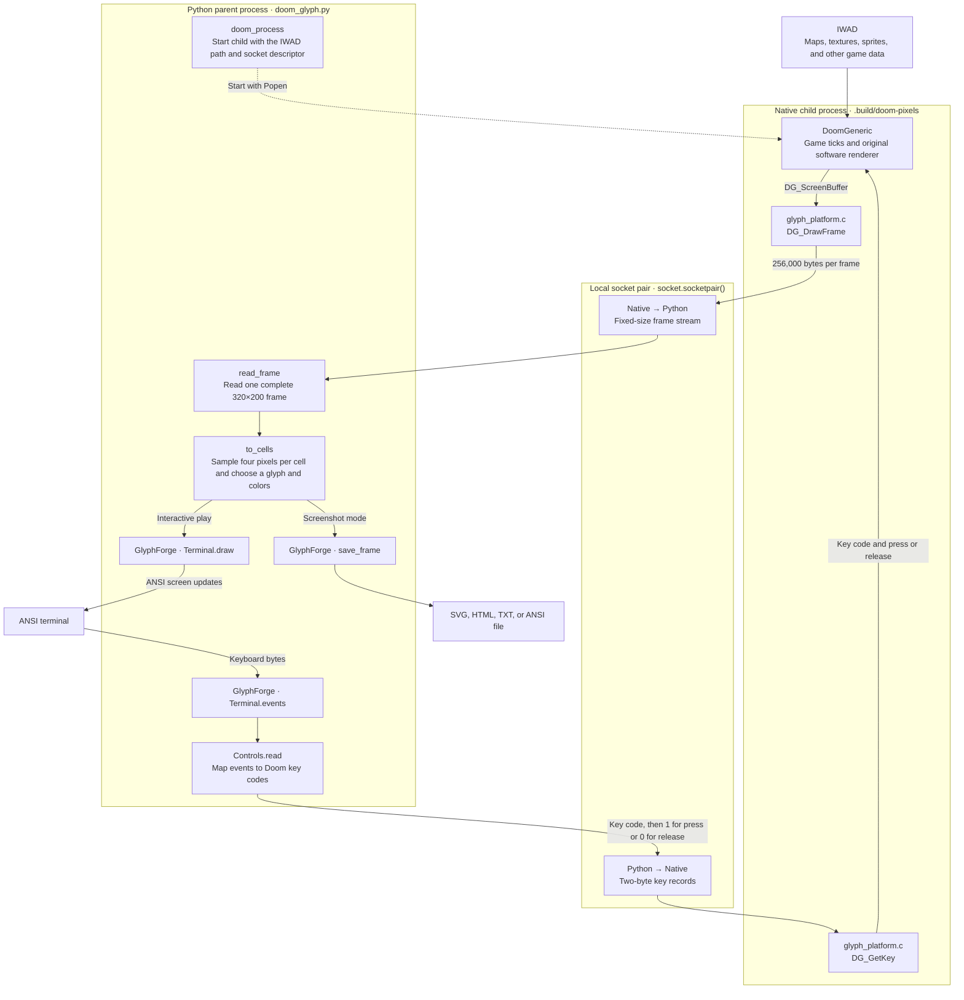

# Glyph Doom

Play the original DOOM in a terminal with colored ASCII graphics. DoomGeneric
runs the game and renders its 320×200 framebuffer. GlyphForge draws the resulting
character grid, reads keyboard events, and exports still frames.


Recorded with Glyph Doom in E1M1 with a former human and a barrel positioned
near the starting area for the demo.

## Quick start

Requires Python 3.10+, Git, a C compiler, Make, curl, and an ANSI terminal.

```sh
git clone --recurse-submodules git@github.com:amirhdolati/glyph-doom.git
cd glyph-doom
./setup.sh
python3 doom_glyph.py --warp 1 1
```

Setup builds [DoomGeneric](https://github.com/ozkl/doomgeneric) from a pinned
revision and downloads the [DOOM 1.8 shareware IWAD](https://www.gamers.org/pub/idgames/idstuff/doom/).
For your own game data, use `./setup.sh --no-shareware` and
`python3 doom_glyph.py --iwad /path/to/doom.wad`. Saves and settings live in
`.state/`. The game runs silently and uses keyboard controls.

| Key | Action |
| --- | --- |
| ↑ / ↓ or W / S | Move forward or backward |
| ← / → | Turn |
| A / D | Strafe |
| Space or F | Fire |
| E | Use or open |
| Shift | Run in terminals that report modifier-key events |
| 1–7 | Select weapon |
| Tab | Automap |
| Esc / Enter | Open menu / select |
| Q | Return to the shell |

Pass `--256` to force the xterm 256-color palette. Terminals that only report
keypresses use short key holds refreshed by keyboard repeat.

## Architecture

`setup.sh` downloads and verifies the pinned DoomGeneric source. The Makefile
links the DoomGeneric core with [`glyph_platform.c`](glyph_platform.c) to
produce `.build/doom-pixels`. The [Python frontend](doom_glyph.py) loads
GlyphForge from the pinned submodule and starts the executable with the chosen IWAD.



1. **Start the game.** `doom_process()` creates the socket pair and gives
   DoomGeneric one endpoint through the inherited descriptor named by
   `DOOM_GLYPH_FD`. The C adapter calls `doomgeneric_Create()`, then repeatedly
   calls `doomgeneric_Tick()` to advance and render the game.
2. **Render to terminal cells.** `DG_DrawFrame()` sends the framebuffer as
   320×200 native 32-bit pixel values, with at least 28 ms between sends.
   Python assembles the full frame from the byte stream, averages four samples
   per cell, and uses luminance to select the ASCII glyph. GlyphForge writes
   ANSI updates for changed cells and redraws after a resize.
3. **Return keyboard input.** Each interactive iteration reads key events from
   GlyphForge before receiving the next frame. `Controls.read()` encodes each
   changed Doom key state as two bytes, which Python writes to the same socket. `DG_GetKey()`
   polls for those records without blocking the game tick.
4. **Export or exit.** Screenshot mode reads frames for roughly 1.5 seconds
   and exports one 120×45 cell frame without opening an interactive terminal.
   During play, `Q` exits the loop, GlyphForge restores the terminal, and
   Python closes the socket and reaps the child process.

## Export a screenshot

```sh
python3 doom_glyph.py --warp 1 1 --screenshot e1m1.svg
```

The exporter also supports `.html`, `.ans`, and `.txt`. For a DOOM II IWAD,
pass one map number to `--warp`.

## Support GlyphForge

You can support GlyphForge development with a donation on TRON. The QR code
below comes from the engine's repository.

[View the GlyphForge donation address on TRONSCAN](https://tronscan.org/#/address/TZ6HTiRLeyWoFJ5rGgx6qbMyjLAHNb6hfb)

[](https://tronscan.org/#/address/TZ6HTiRLeyWoFJ5rGgx6qbMyjLAHNb6hfb)

## License

Glyph Doom is licensed under GPL-2.0-or-later. See [COPYING](COPYING).
[GlyphForge](https://github.com/amirhdolati/glyphforge-engine) is an independent
MIT-licensed dependency. DOOM game data is supplied separately.
