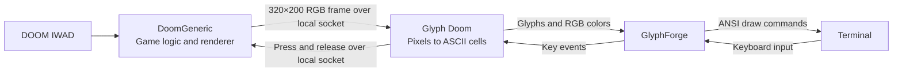
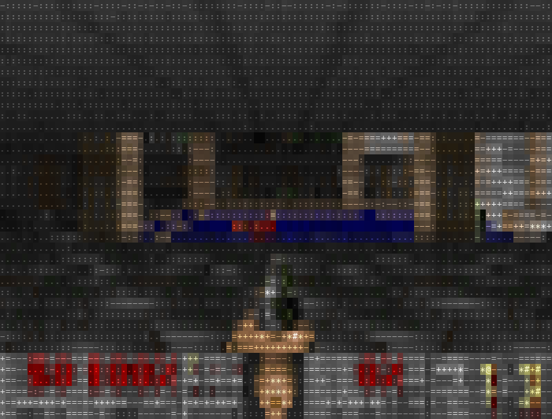

# Glyph Doom

Play the original DOOM in a terminal with colored ASCII graphics. DoomGeneric
runs the game and renders its 320×200 framebuffer. GlyphForge draws the resulting
character grid, reads keyboard events, and exports still frames.


## Quick start

You need Python 3.10+, Git, a C compiler, Make, curl, and an ANSI terminal.
On macOS, install the Xcode Command Line Tools if you need a compiler.

```sh
git -c url.https://github.com/.insteadOf=git@github.com: clone --recurse-submodules https://github.com/amirhdolati/glyph-doom.git
cd glyph-doom
./setup.sh
python3 doom_glyph.py --warp 1 1
```

The clone command uses HTTPS for public downloads. The GlyphForge submodule
records its SSH URL, so contributors with GitHub SSH access can also clone
`git@github.com:amirhdolati/glyph-doom.git` with `--recurse-submodules`.
The submodule pins the engine version and provides the Python package directly.

Setup builds [DoomGeneric](https://github.com/ozkl/doomgeneric) from a pinned
revision and downloads the [DOOM 1.8 shareware IWAD](https://www.gamers.org/pub/idgames/idstuff/doom/).
For your own game data, use `./setup.sh --no-shareware` and
`python3 doom_glyph.py --iwad /path/to/doom.wad`. Saves and settings live in
`.state/`. The game runs silently and uses keyboard controls.

| Key | Action |
| --- | --- |
| ↑ / ↓ or W / S | Move forward or backward |
| ← / → | Turn |
| A / D | Strafe |
| Space or F | Fire |
| E | Use or open |
| Shift | Run in terminals that report modifier-key events |
| 1–7 | Select weapon |
| Tab | Automap |
| Esc / Enter | Open menu / select |
| Q | Return to the shell |

Pass `--256` to force the xterm 256-color palette. Terminals that only report
keypresses use short key holds refreshed by keyboard repeat.

## How it works



`doom_glyph.py` launches the native executable and converts its frames to
GlyphForge cells. `glyph_platform.c` bridges DoomGeneric's display, timer, and
keyboard callbacks to the local process. The build goes in `.build/` and the
pinned display library lives in `vendor/glyphforge-engine/`.

## Export a screenshot

```sh
python3 doom_glyph.py --warp 1 1 --screenshot e1m1.svg
```

The exporter also supports `.html`, `.ans`, and `.txt`. For a DOOM II IWAD,
pass one map number to `--warp`.



## Support GlyphForge

You can support GlyphForge development with a donation on TRON. The QR code
below comes from the engine's repository.

[View the GlyphForge donation address on TRONSCAN](https://tronscan.org/#/address/TZ6HTiRLeyWoFJ5rGgx6qbMyjLAHNb6hfb)

[](https://tronscan.org/#/address/TZ6HTiRLeyWoFJ5rGgx6qbMyjLAHNb6hfb)

## License

Glyph Doom is licensed under GPL-2.0-or-later. See [COPYING](COPYING).
[GlyphForge](https://github.com/amirhdolati/glyphforge-engine) is an independent
MIT-licensed dependency. DOOM game data is supplied separately.
