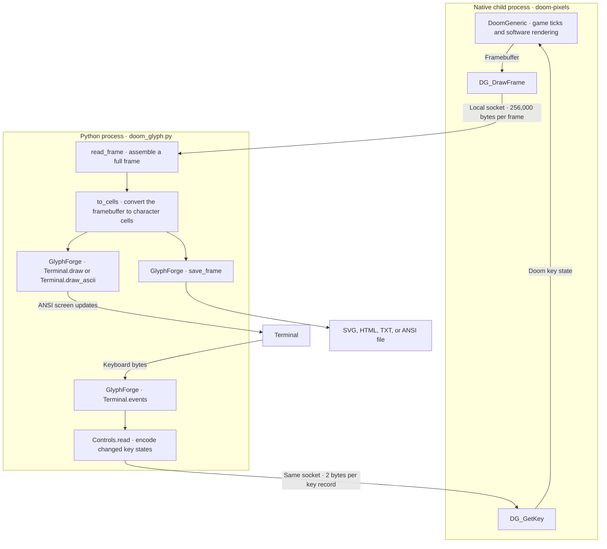

# Runtime architecture

The Python frontend starts the native DoomGeneric executable and connects it
to the terminal through GlyphForge. A local socket pair carries game frames
in one direction and key records in the other.

- **Startup.** [setup.sh](../setup.sh) downloads the pinned DoomGeneric source.
  The [Makefile](../Makefile) links it with
  [glyph_platform.c](../glyph_platform.c) to build `.build/doom-pixels`.
  The [Python frontend](../doom_glyph.py) passes the chosen IWAD path and one
  inherited socket descriptor to the child process.
- **Frames.** DoomGeneric produces a 320×200 framebuffer with four bytes per
  pixel. Python reads a complete frame, averages four samples for each
  terminal cell, and picks a glyph from the resulting brightness. GlyphForge
  updates changed cells in color mode. In `--ascii` mode, GlyphForge's
  `raster_to_ascii` converts the RGB framebuffer to a monochrome character
  grid, and `Terminal.draw_ascii` writes those glyphs using the terminal's
  default colors. Both modes redraw the screen after a resize.
- **Input.** Each interactive iteration reads terminal events before receiving
  its next frame. Python sends a Doom key code followed by `1` for press or
  `0` for release. The native adapter polls those records without blocking.
- **Capture and exit.** Screenshot mode exports a 120×45 cell frame without
  opening an interactive terminal. During play, `Q` closes the session and
  GlyphForge restores the terminal.
